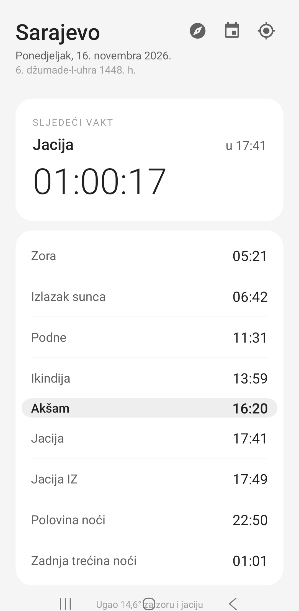
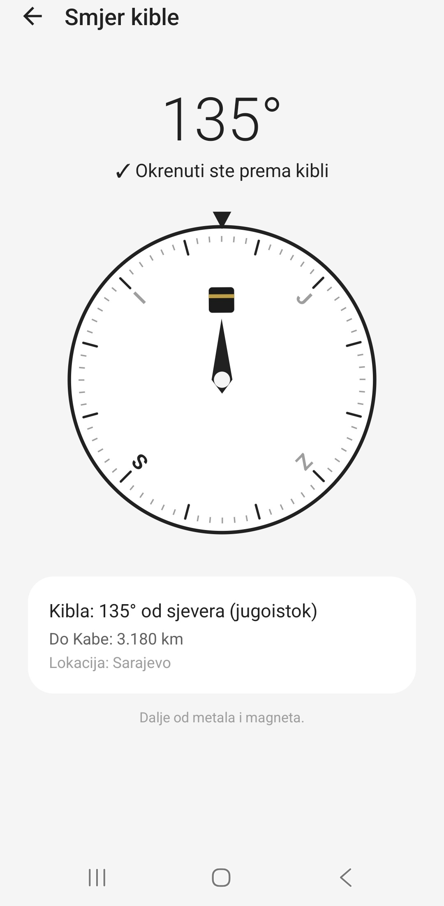
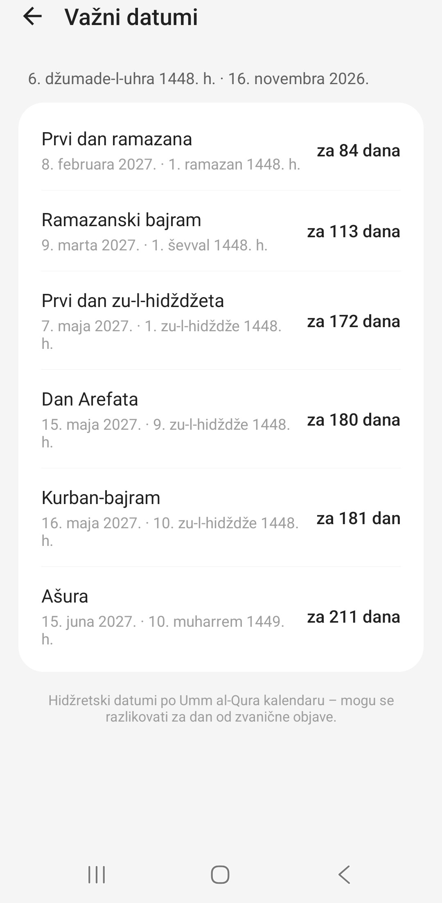

# Vaktija

**🌐 Web:** [vaktijadev.pages.dev](https://vaktijadev.pages.dev)  
**📱 Android:** [preuzmi najnoviju verziju (APK)](https://github.com/amarhusika/vaktija/releases/download/v1.0/vaktija.apk)

<p>
  
  
  
</p>

Minimalistička aplikacija za namaska vremena: Android i web.

- Današnja vremena i odbrojavanje do sljedećeg vakta
- Kratak beep kada nastupi vakat
- Ramazanski režim: Sabah IZ i Jacija IZ
- Kibla kompas
- Obavijest za važne datume dan prije (ramazan, bajrami, Arefat, Ašura)
- Bilo koji grad (pretraga) ili trenutna lokacija

Web verzija ima i mjesečnu i godišnju vaktiju, s preuzimanjem u PDF-u.

Vremena se računaju na telefonu, bez interneta: ugao 14,6° za zoru i jaciju.
Bez biblioteka, bez rada u pozadini osim jednog alarma za sljedeći vakat.

## Struktura

- `android/` – Android aplikacija (Kotlin)
- `web/` – web verzija (React, TypeScript, Vite)

## Android

1. U Android Studiju otvorite folder `android`.
2. Sačekajte da se završi Gradle sinhronizacija.
3. Povežite uređaj ili pokrenite emulator i odaberite **Run**.

Potreban je Android 8.0 ili noviji.

## Web

```
cd web
npm install
npm run dev
```

Za objavu: `npm run build`, rezultat je u `web/dist`.
